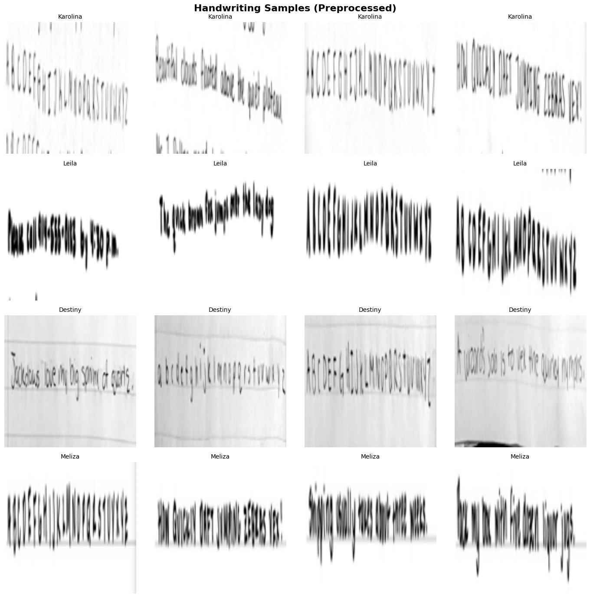
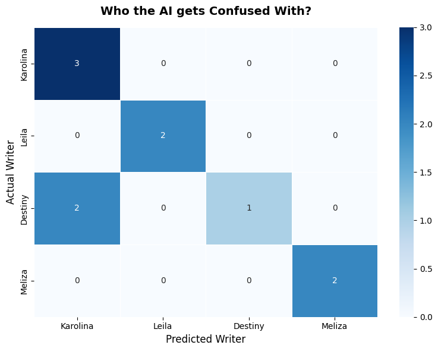
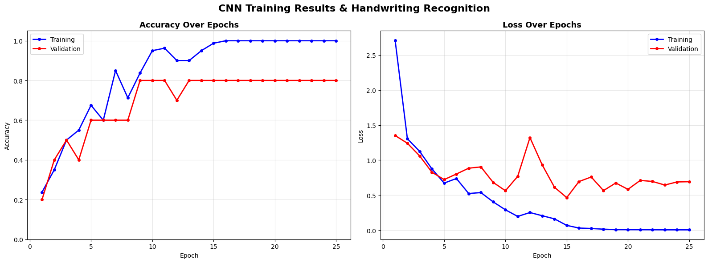
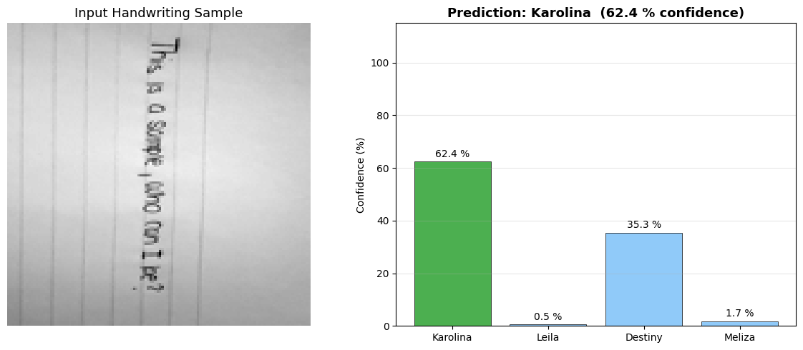

# Handwriting AI: Writer Identification with a CNN

A convolutional neural network (CNN) that identifies **which of 4 people wrote a handwriting sample**. Writer identification is the technique behind document forensics and signature-fraud checks: it asks whether a given person wrote a given page.

**Result:** 80% accuracy on the held-out test set (8 of 10 images), macro F1 0.81.

## How it works

1. **Data:** 100 scanned handwriting images, 25 per writer, one folder per writer.
2. **Preprocessing:** convert to grayscale, resize to 128 × 128, scale pixel values to [0, 1].
3. **Split:** stratified 80 / 10 / 10 into training (80 images), validation (10) and test (10).
4. **Model:** two convolution + max-pooling blocks (16 and 32 filters), a 64-unit dense layer and a 4-way softmax (1.85M parameters).
5. **Training:** Adam (learning rate 0.001), batch size 8, up to 50 epochs, with early stopping (patience 10), learning-rate reduction on plateau, and checkpointing of the best validation accuracy. Training stopped at epoch 25 and kept the weights from epoch 15.

## Results

| Writer | Precision | Recall | Test images |
|---|---|---|---|
| Karolina | 0.60 | 1.00 | 3 |
| Leila | 1.00 | 1.00 | 2 |
| Destiny | 1.00 | 0.33 | 3 |
| Meliza | 1.00 | 1.00 | 2 |
| **Overall** | **Accuracy 80%** | **Macro F1 0.81** | **10** |

The only mistakes: 2 of Destiny's 3 test samples were classified as Karolina's.

Training accuracy reached 100% while validation accuracy leveled off at 80%, and validation loss rose after epoch 15. With only 100 images, the model starts to memorize the training set (overfitting); early stopping kept the best checkpoint.

## Try it

The last cell lets you upload a new handwriting image and returns the predicted writer with a confidence score for each person.

## Run it

1. Click **Open in Colab** above.
2. Prepare a zip with one folder per writer (`Karolina/`, `Leila/`, `Destiny/`, `Meliza/`), each holding that person's handwriting images (PNG or JPG).
3. Run all cells and upload the zip when prompted.

The original dataset isn't included because it contains personal handwriting samples.

## Tech stack

Python · TensorFlow / Keras · scikit-learn · NumPy · Pillow · Matplotlib · Seaborn · Google Colab

## Limitations and next steps

- **Small test set:** with 10 test images, each one is worth 10 points of accuracy. K-fold cross-validation would give a more reliable score.
- **Overfitting:** apply augmentation (rotation, shift, zoom) to the training images and collect more samples per writer.
- **Transfer learning:** fine-tune a pretrained CNN (e.g., MobileNet or ResNet) instead of training from scratch.
- **Verification:** a Siamese network could answer "did this person write this?" for writers the model has never seen, closer to real signature-fraud detection.
